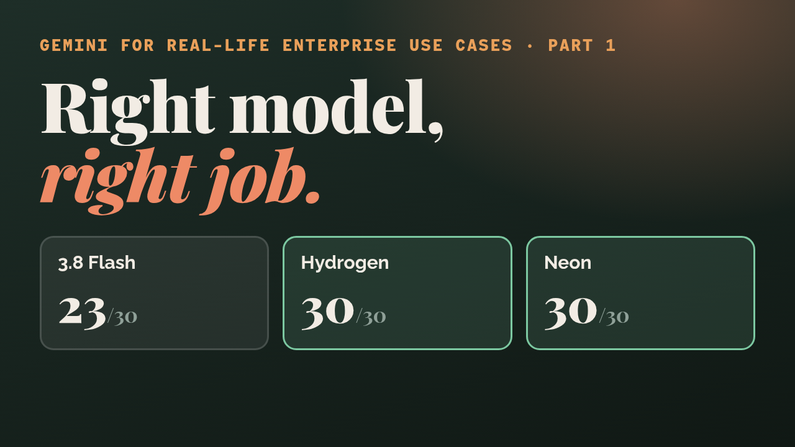

# Gemini for Real-Life Enterprise Use Cases

Script-graded tests of Gemini 4 Hydrogen, Gemini 4 Neon and Gemini 3.8 Flash on real enterprise workflows (financial reporting analysis, meeting and call intelligence, review and controls), using Alphabet's public Q3 2026 filings as stand-in data. Each test reports accuracy, wall-clock time and cost per task, so architects can pick the right model for each job. Read the results on the live site, or clone the repo and rerun every test on your own Google Cloud project or Gemini API key.

[](https://youtu.be/rWk_GcL1MH4)
[](https://gemini4.cloudrace.info/)
[](https://gemini4.cloudrace.info/)
[](#installation)
[](#disclaimer)
[](LICENSE)

> **Authored and built by:** Kanchana Patlolla
> **Notice:** Independent practitioner evaluation, not an official Google benchmark. Results apply to these tasks only ([details](#disclaimer)).

## Table of contents

- [Prefer to watch?](#prefer-to-watch)
- [The series](#the-series)
- [Results at a glance](#results-at-a-glance)
- [Part 2: Ask once, verify everywhere](#part-2-ask-once-verify-everywhere)
- [Installation](#installation)
- [Usage](#usage)
- [Repository layout](#repository-layout)
- [Local development](#local-development)
- [Publishing the site](#publishing-the-site)
- [Troubleshooting and FAQ](#troubleshooting-and-faq)
- [Contributing](#contributing)
- [License](#license)
- [Disclaimer](#disclaimer)

## Prefer to watch?

Part 1, **Right Model, Right Job**, as a 4.5-minute video: the paradigm shift, the Neon model card, all three use cases, and the author's verification rerun.

[](https://youtu.be/rWk_GcL1MH4)

<details>
<summary>Chapters</summary>

- [0:00](https://youtu.be/rWk_GcL1MH4?t=0) Demos vs enterprise reality
- [0:33](https://youtu.be/rWk_GcL1MH4?t=33) The paradigm shift: from one model to a team of models
- [0:56](https://youtu.be/rWk_GcL1MH4?t=56) Reading the Gemini 4 Neon model card
- [1:25](https://youtu.be/rWk_GcL1MH4?t=85) The test: three enterprise workflows
- [1:43](https://youtu.be/rWk_GcL1MH4?t=103) How we tested
- [1:55](https://youtu.be/rWk_GcL1MH4?t=115) Use case 1: Financial reporting analysis
- [2:19](https://youtu.be/rWk_GcL1MH4?t=139) Use case 2: Meeting and call intelligence
- [2:42](https://youtu.be/rWk_GcL1MH4?t=162) Use case 3: Review and controls
- [3:05](https://youtu.be/rWk_GcL1MH4?t=185) At enterprise scale
- [3:17](https://youtu.be/rWk_GcL1MH4?t=197) Verified: rerun by the author
- [3:27](https://youtu.be/rWk_GcL1MH4?t=207) Route by workflow
- [3:45](https://youtu.be/rWk_GcL1MH4?t=225) Why enterprises should take this seriously
- [4:23](https://youtu.be/rWk_GcL1MH4?t=263) Next: Part 2, Ask once, verify everywhere

</details>

## The series

| Part | Title | Enterprise question | Status |
|---|---|---|---|
| 1 | **Right Model, Right Job** | Which Gemini model should run each workflow? | Results below |
| 2 | **Ask Once, Verify Everywhere** | Can every answer be traced to its exact line or timestamp across a filing, a prior filing, an earnings release and a call video? | [Results below](#part-2-ask-once-verify-everywhere) |

Every test is an enterprise workflow first. Alphabet's public filings are only the stand-in data, so anyone can rerun the tests.

| Test | Enterprise use case | Who owns it | Where else this applies |
|---|---|---|---|
| Analyst | Financial reporting analysis | Office of the CFO, FP&A, research | Supplier health checks, competitor tracking, covenant monitoring |
| Intake | Meeting and call intelligence | Investor relations, strategy, sales | Board meetings, customer QBRs, contact-center QA |
| Audit | Review and controls | Controllership, internal audit, compliance | Regulatory filings, contracts, invoices, claims |
| Verify (Part 2) | Research and due diligence | Corporate development, risk, legal, IR | M&A diligence, vendor and credit reviews, analyst briefings |

## Results at a glance

Median of 5 runs per setup, list prices, Vertex AI `global` endpoint, 2026-11-20. Full data: [results/summary.json](results/summary.json). Method: [docs/approach.md](docs/approach.md).

| Test (use case) | Hydrogen low | Hydrogen high | 3.8 Flash | Neon high |
|---|---|---|---|---|
| **Analyst** (financial reporting), 25 questions | 100% · 18 s · \$0.11 | 100% · 25 s · \$0.12 | 100% · 38 s · \$0.07 | 100% · 61 s · \$0.29 |
| **Intake** (call intelligence), 20 questions | 100% · 39 s · \$0.33 | 100% · 40 s · \$0.33 | 100% · **31 s** · **\$0.15** | 100% · 33 s · \$0.67 |
| **Audit** (review and controls), 6 planted errors | 28/30 · 30 s · \$0.12 | **30/30** · 204 s · \$0.34 | 23/30 · 268 s · \$0.28 | **30/30** · 420 s · \$0.95 |

**Verified by the author.** After publishing, Kanchana Patlolla reran all three tests from the command line (screen-recorded, 2026-11-20T2212Z) with `scripts/run_all.py`. Every accuracy result matched: 100% on analysis and intake, 6/6 audit errors for Hydrogen high and Neon, and the same missed error (e5) for Hydrogen low and 3.8 Flash. Each call's API receipt (`response_id`, `model_version`, `create_time`) is saved. See [results/verification/](results/verification/).

**What it means:**

1. **Extraction is solved.** All setups scored 100% on analysis and call intake, so choose by speed and cost.
2. **Review needs the new generation.** Hydrogen high and Neon found every planted error on every run, with zero false flags. 3.8 Flash found 77%.
3. **Hydrogen is the default worker.** It matched Neon on document work at about a third of the cost. Neon's lead shows in Part 2, where it was the only setup to verify every multi-source answer.

## Part 2: Ask once, verify everywhere

**Enterprise use case:** research and due diligence. One call gets four sources (Q3 and Q2 10-Qs, the earnings release, the 34-minute call video) and 14 questions. Each answer must cite a verbatim quote or a call timestamp per source. A script checks every citation. The release carries two planted conflicts the models are not told about.

| Setup | Fully verified (of 70) | Time | Cost per run |
|---|---|---|---|
| Neon high | **70** | 203 s | \$1.34 |
| Hydrogen high | 69 | 130 s | \$0.64 |
| Hydrogen low | 65 | 54 s | \$0.55 |
| 3.8 Flash high | 64 | 185 s | \$0.34 |

- **The decider:** a free-cash-flow figure the 10-Qs don't contain. Only the call exposes the planted release value. Neon caught it 5/5, Hydrogen high 4/5, 3.8 Flash 2/5, Hydrogen low 0/5.
- **Route by risk:** Neon when the answer goes straight into a decision; Hydrogen high when a person reviews it.
- **Disclosed:** 3.8 Flash hit the 32K output cap on 3 of 5 runs, so its runs use 64K. One grading change after the pilot accepts a filing's own rounded wording. An easier first version (every setup 12/12) is in `data/part2/pilot_v1/`.

Explore every answer and citation on the [live site](https://gemini4.cloudrace.info/#/part2). Method: [docs/approach.md](docs/approach.md#part-2-ask-once-verify-everywhere).

## Installation

**Prerequisites**

- Python 3.10 or later. The race harness uses the standard library only; nothing to `pip install`.
- One of:
  - A [Gemini API key](https://aistudio.google.com/apikey), or
  - A Google Cloud project with the [Vertex AI API](https://console.cloud.google.com/apis/library/aiplatform.googleapis.com) enabled and the [gcloud CLI](https://cloud.google.com/sdk/docs/install) signed in.
- Budget: a full 5-run pass of all three tests costs about \$25 at list price.

**Steps**

```bash
git clone https://github.com/kanchpat/gemini4-enterprise-races.git
cd gemini4-enterprise-races

# Option A: Gemini API
export GEMINI_API_KEY="your-key"

# Option B: Vertex AI (takes precedence if set)
export GOOGLE_CLOUD_PROJECT="your-project-id"
export GOOGLE_CLOUD_LOCATION="global"   # optional, default global
```

For Vertex AI, the harness reads a token from `ACCESS_TOKEN`, then from the command in `ACCESS_TOKEN_CMD`, then from `gcloud auth print-access-token`.

## Usage

Run all three tests in one go (1 run per setup, about \$4 and 10 minutes). Results go to a new `results/verification/<timestamp>/` folder, followed by a summary table and the API receipt for every call (`response_id`, `model_version`, `create_time`):

```bash
python3 scripts/run_all.py            # add --runs 5 for a full pass (about \$19)
```

Or run each test on its own (all four model setups run in parallel):

```bash
python3 races/race1_analyst.py --runs 5          # Analyst: financial reporting analysis
python3 races/race2_intake.py  --runs 5          # Intake: earnings-call video, no transcript
python3 races/race_hard.py --task audit  --runs 5  # Audit: find 6 planted errors
python3 races/race_hard.py --task ladder --runs 1  # Ladder: multi-step reasoning (pilot)
python3 races/part2_verify.py --runs 5            # Part 2: four sources, verified citations (~$15)
```

Each run appends one JSON line per model call to `results/*.jsonl` (answer, tokens, seconds, cost, grade). Use `--out path.jsonl` to write somewhere else, so your runs don't mix with the published ones.

Summarize medians and ranges:

```bash
python3 scripts/summarize.py --print
```

Example output:

```text
### audit: Review and controls

| Setup | Runs | Accuracy (median) | Time (median) | Cost (median) |
|---|---|---|---|---|
| Gemini 4 Hydrogen (low) | 5 | 28/30 errors | 30 s | $0.123 |
| Gemini 4 Hydrogen (high) | 5 | 30/30 errors | 204 s | $0.336 |
```

## Repository layout

| Path | What's in it |
|---|---|
| [races/](races/) | Test harness: `common.py` (model calls, timing, cost), one script per test |
| [data/](data/) | Source text, answer keys (from SEC XBRL facts and call timestamps), planted-error list |
| [results/](results/) | Raw per-run JSONL, `summary.json`, `pilot/` single runs, and `verification/` reruns with API receipts |
| [docs/approach.md](docs/approach.md) | Approach and reasoning: design choices, grading, how the method changed, limitations |
| [site/src/](site/src/) | Source for the live site (template, styles, script) |
| [scripts/](scripts/) | `summarize.py` and `build_site.py` |
| `docs/index.html` | Generated single-file site served by GitHub Pages; don't edit by hand |

## Local development

```bash
python3 scripts/summarize.py            # refresh results/summary.json
python3 scripts/build_site.py           # inline site/src + summary into docs/index.html
python3 -m http.server 8000 --directory docs
```

Open http://localhost:8000. Hard-refresh (`Cmd/Ctrl + Shift + R`) after each rebuild.

To add a test, copy the shape of `races/race1_analyst.py`: build a prompt, call `common.generate()`, grade against a key in `data/`, and append with `common.append_jsonl()`. Then add it to `TESTS` in `scripts/summarize.py`.

## Publishing the site

The site is served by [GitHub Pages](https://docs.github.com/pages) straight from the `docs/` folder, with no build step on GitHub:

1. Rebuild locally (`python3 scripts/build_site.py`) and commit `docs/index.html`.
2. Push to `main`. Pages redeploys `docs/` within a minute or two.
3. One-time setup: **Settings → Pages → Build and deployment → Source: Deploy from a branch**, branch `main`, folder `/docs`.
4. Custom domain: `docs/CNAME` holds `gemini4.cloudrace.info`. Point a DNS `CNAME` record for `gemini4` at `kanchpat.github.io`, then turn on **Enforce HTTPS**.

## Troubleshooting and FAQ

**HTTP 400 "API key not valid" while using Vertex AI.** A stale `GEMINI_API_KEY` is set. Vertex wins only if `GOOGLE_CLOUD_PROJECT` is set; set it or unset the key.

**HTTP 403 or 404 on a model.** Check that the model ID (`gemini-4-hydrogen`, `gemini-4-neon`, `gemini-3.8-flash`) is available to your project and region. Use `GOOGLE_CLOUD_LOCATION=global`.

**Neon at extra-high thinking returns nothing.** It can spend the whole 65,536-token output budget on thinking. We left it out of the published results.

**Why are my times different?** Latency depends on region, time of day and load. Compare setups within one run, not across days.

**Why no Gemini 4 Carbon?** Carbon isn't yet generally available for businesses (it's limited to the Fairwind program). We'll add it when it is.

**Why no non-Google models?** The series is about choosing between Gemini models.

## Contributing

Reruns, answer-key fixes and new enterprise workflows are welcome. See [CONTRIBUTING.md](CONTRIBUTING.md). Ground rules: grade by script, publish ties and losses, and disclose any grading change.

## License

[Apache License 2.0](LICENSE). Source documents in `data/` are public SEC filings by Alphabet Inc.

## Disclaimer

Independent practitioner evaluation by Kanchana Patlolla. Not an official Google benchmark, product documentation or financial advice. Results apply to these tasks, on these dates, at these prices only. Gemini 3.8 Flash costs reflect a promotional price that ends 2026-12-31. Alphabet filings are used only as public, verifiable test data. Sources: the [Gemini 4 Hydrogen](https://blog.google/innovation-and-ai/models-and-research/gemini-models/introducing-gemini-4-hydrogen/), [Neon](https://blog.google/innovation-and-ai/models-and-research/gemini-models/introducing-gemini-4-neon/) and [Carbon](https://blog.google/innovation-and-ai/models-and-research/gemini-models/introducing-gemini-4-carbon/) launch posts, [Gemini API pricing](https://ai.google.dev/gemini-api/docs/pricing), and [Alphabet's Q3 2026 10-Q](https://www.sec.gov/Archives/edgar/data/1652044/000165204426000084/goog-20260930.htm).
